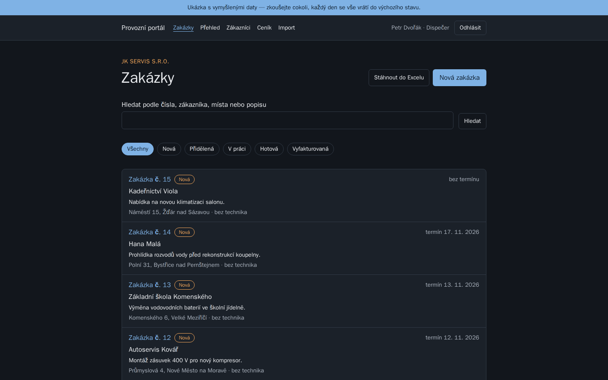
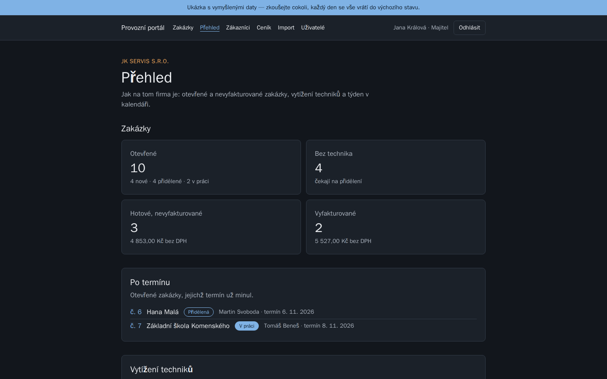
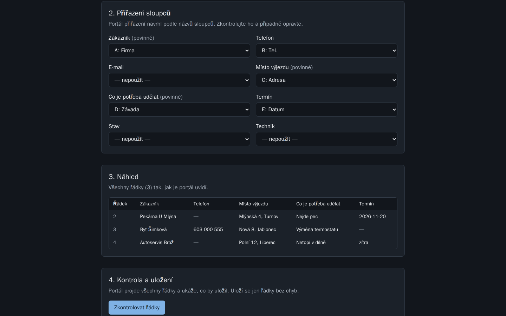
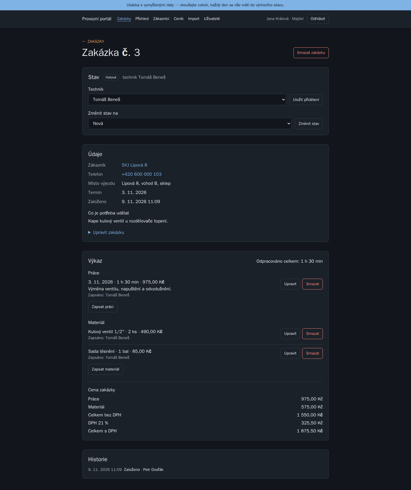
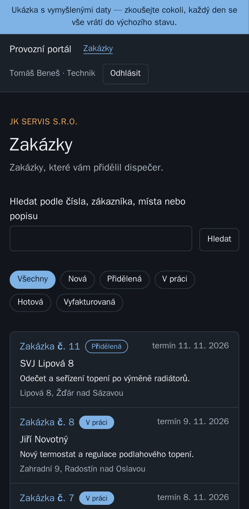
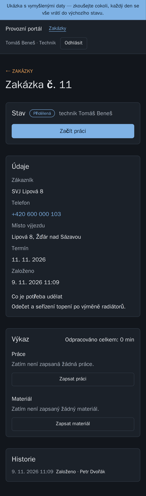

# Operations portal — service jobs instead of Excel

[Česky](README.md)

A web app for a small service company (plumbers, electricians, heating
technicians) that has been running its jobs and call-outs in Excel. The
dispatcher creates and assigns jobs, the technician handles them on a phone
and logs work and materials, the owner sees an overview and the price of
every job.

**The demo's main trick: upload your own Excel sheet and see it as an app
right away.** The company does not have to retype anything.

It is a portfolio demo for a made-up company, **JK servis s.r.o.** All data
is made up. The app itself is in Czech.

**Try it:** <https://provozni-portal-dev.up.railway.app/prihlaseni> — on the sign-in page,
just click “Vyzkoušet jako Majitel / Dispečer / Technik” (owner /
dispatcher / technician). The data resets to its initial state every day.

## Screenshots

| Jobs (dispatcher)                    | Owner overview                       |
| ------------------------------------ | ------------------------------------ |
|  |  |

| Importing your own Excel sheet    | Job with work log and price           |
| --------------------------------- | ------------------------------------- |
|  |  |

| Technician on a phone                       | Their job                                                  |
| ------------------------------------------- | ---------------------------------------------------------- |
|  |  |

## What it does

- **Three roles.** The owner can do everything, including the price list
  and users. The dispatcher creates and assigns jobs. A technician sees only
  their own jobs and never sees prices.
- **Customers and jobs:** list with search (diacritics optional), detail,
  create, edit, delete with confirmation. Every change is written to the
  history.
- **Assignment and statuses:** new → assigned → in progress → done →
  invoiced. On a phone, the technician starts work and marks the job done
  with a single tap.
- **Work log:** time worked, materials from the price list or typed in,
  a note.
- **Price list and job price:** hourly rate and materials. The price is
  calculated without VAT, with 21% VAT and in total. Every log row keeps
  the price from the moment it was written, so later price-list changes do
  not reprice old jobs.
- **Excel import:** upload a sheet, columns are mapped automatically by
  their names, preview, a check of every row. Only rows without errors are
  saved. A sample file is available for download.
- **Export back to Excel** with the current filter, with prices only for
  those allowed to see them.
- **Owner overview:** open and uninvoiced jobs, overdue jobs, technician
  workload, the week in a calendar.
- **Demo mode:** one-click sign-in and a data reset on the first visit of
  a new day. The three demo accounts cannot be changed or deleted.

## Interesting decisions

- **Permissions are enforced by the server in the database query**, not
  by a hidden button. A technician opening someone else's job gets a 404,
  exactly like for an address that does not exist. The response gives away
  nothing about what is in the system.
- **Technicians do not get prices even in the server response**, not just
  on screen.
- **Money in hundredths.** Prices are calculated in whole haléře (Czech
  cents), so the sum of the rows always matches the total.
- **Excel is an input, not an enemy.** The file is never stored, only read.
  The check catches a forged file (a “zip bomb”) and a sheet over the limit.
- **Demo reset without another service.** Instead of a scheduled job that
  would run at night, the data resets on the first visit of a new day. The
  reset is guarded by a database lock, so two simultaneous visitors cannot
  run it twice.
- **Cheap to run:** the app sleeps when idle and the database runs on
  a shared server with its own user. Estimated $0–2 per month.

## Technology

| Part                             | What and why                                                    |
| -------------------------------- | --------------------------------------------------------------- |
| Next.js 16, React 19, TypeScript | pages are rendered on the server, data never leaves permissions |
| Better Auth                      | sign-in, rate limiting, a link to set a password                |
| Tailwind CSS 4                   | look, light and dark mode, phone                                |
| PostgreSQL 18, Prisma 7          | database, schema changes only via migrations                    |
| zod                              | validation of everything that comes from the browser            |
| Playwright + axe                 | browser tests on desktop and phones, accessibility WCAG 2.2 AA  |
| Docker Compose                   | development and tests run the same on every machine             |

## Running it

```
docker compose up -d
```

The app runs at http://localhost:3200. Nothing else needs to be installed;
`docker compose run --rm web npm run db:seed` fills in sample data.

## Tests

```
docker compose --profile test run --rm e2e
```

**149 tests** in three browsers: Chrome on desktop, Android and iPhone
(Safari). They check the permissions of all three roles, the main flows,
that nothing overflows sideways on a phone, and the accessibility of every
screen in light and dark mode. Demo mode has its own suite
(`npx playwright test -c playwright.ukazka.config.ts`). Tests have their own
database and server; the whole suite also runs on GitHub Actions against
the production build.

## How it was made

**The code was written by AI — Claude Code from Anthropic — in dialogue
with me.** I do not hide it, because this is exactly what I offer: taking
a real application all the way with AI so that it is secure, tested and
maintainable.

My role (Jakub Košťan): the brief and the phase plan, decisions on
permissions (who may see and change what), prices, VAT and running costs,
approving every plan before work and checking the result. I led the last
steps remotely from my phone.

The portal was built in three days (Nov 7–9, 2026) in 23 commits, step by
step with a plan before the work and a summary after it. Every step got
tests, and only after the whole suite passed was it reported as done.
