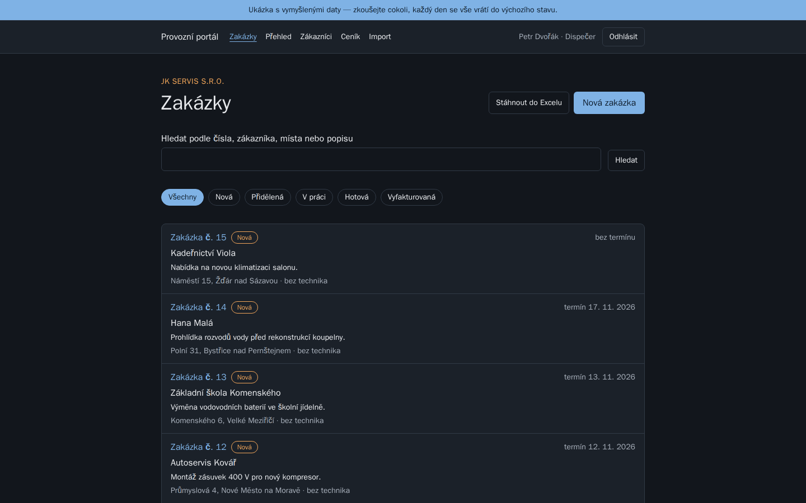
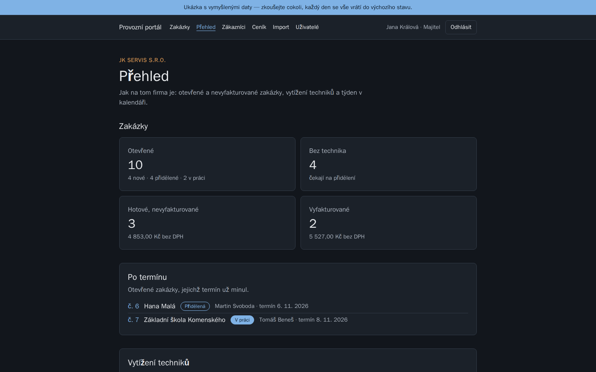
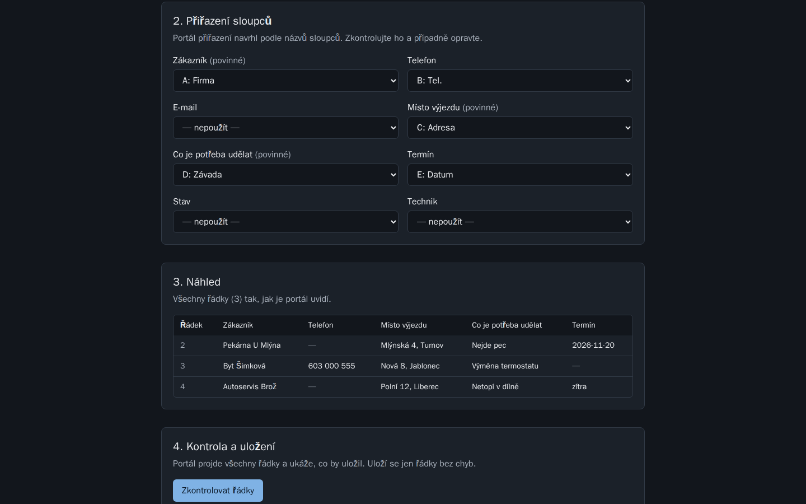
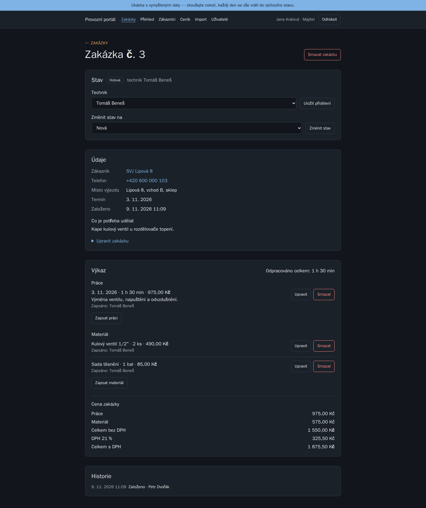
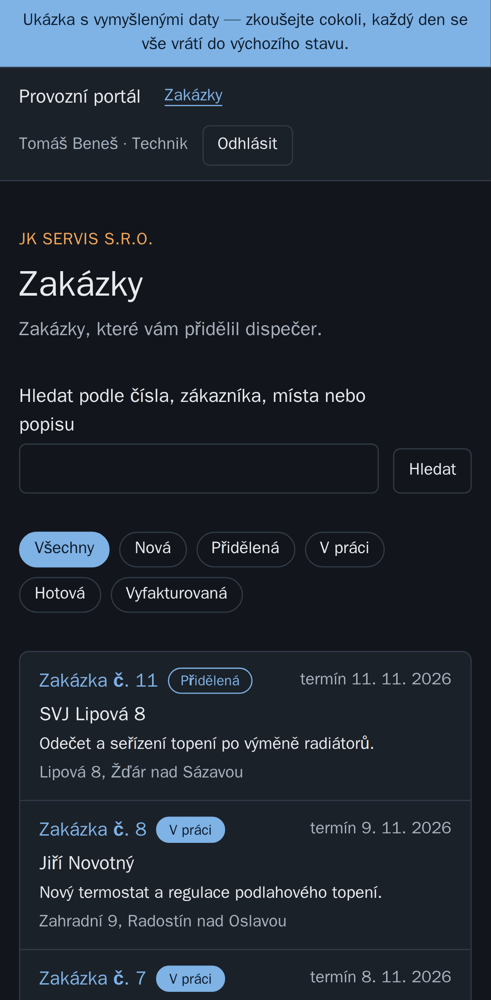
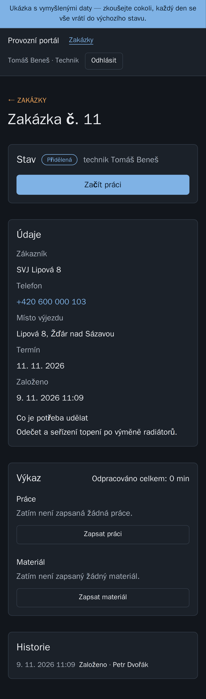

# Provozní portál — servisní zakázky místo Excelu

[English](README.en.md)

Webová aplikace pro malou servisní firmu (instalatéři, elektrikáři, topenáři),
která dosud vede zakázky a výjezdy v Excelu. Dispečer zakázky zakládá
a přiděluje, technik je vyřizuje v telefonu a zapisuje práci a materiál,
majitel vidí přehled a cenu každé zakázky.

**Hlavní kouzlo ukázky: nahrajete vlastní tabulku z Excelu a hned ji uvidíte
jako aplikaci.** Firma nemusí nic přepisovat.

Je to ukázka do portfolia pro vymyšlenou firmu **JK servis s.r.o.** Všechna
data jsou vymyšlená.

**Vyzkoušejte si to:** _odkaz na živou ukázku doplním po nasazení_ — na
přihlašovací stránce stačí kliknout na „Vyzkoušet jako Majitel / Dispečer /
Technik“. Data se každý den vrátí do výchozího stavu.

## Snímky

| Zakázky (Dispečer)                         | Přehled pro majitele                |
| ------------------------------------------ | ----------------------------------- |
|  |  |

| Import vlastní tabulky z Excelu   | Zakázka s výkazem a cenou                 |
| --------------------------------- | ----------------------------------------- |
|  |  |

| Technik v telefonu                               | Jeho zakázka                                                   |
| ------------------------------------------------ | -------------------------------------------------------------- |
|  |  |

## Co umí

- **Tři role.** Majitel smí všechno včetně ceníku a uživatelů. Dispečer
  zakládá a přiděluje zakázky. Technik vidí jen své zakázky a ceny nevidí
  vůbec.
- **Zákazníci a zakázky:** seznam s hledáním (i bez diakritiky), karta,
  založení, úprava, smazání s potvrzením. Každá změna se zapíše do historie.
- **Přidělení a stavy:** nová → přidělená → v práci → hotová →
  vyfakturovaná. Technik v telefonu jedním tlačítkem začne práci a označí
  zakázku za hotovou.
- **Výkaz:** odpracovaný čas, materiál z ceníku nebo ručně, poznámka.
- **Ceník a cena zakázky:** hodinová sazba a materiál. Cena se dopočítá bez
  DPH, s DPH 21 % a celkem. Každý řádek výkazu si pamatuje cenu z chvíle
  zápisu, takže pozdější změna ceníku staré zakázky nepřepočítá.
- **Import z Excelu:** nahrání tabulky, návrh přiřazení sloupců podle
  názvů, náhled, kontrola každého řádku. Uloží se jen řádky bez chyb.
  Ke stažení je vzorový soubor.
- **Export zpět do Excelu** se zvoleným filtrem, s cenou jen pro toho, kdo
  ji smí vidět.
- **Přehled pro majitele:** otevřené a nevyfakturované zakázky, zakázky po
  termínu, vytížení techniků, týden v kalendáři.
- **Ukázkový režim:** přihlášení jedním klikem a obnova dat při prvním
  otevření nového dne. Tři ukázkové účty nejdou změnit ani zrušit.

## Zajímavá rozhodnutí

- **Oprávnění hlídá server v dotazu do databáze**, ne skryté tlačítko.
  Technik na adrese cizí zakázky dostane 404, stejně jako na adrese, která
  neexistuje. Z odpovědi se nedá vyčíst, co v systému je.
- **Technik ceny nevidí ani v odpovědi serveru**, nejen na obrazovce.
- **Peníze v haléřích.** Ceny se počítají v celých haléřích, aby součet
  řádků vždycky seděl s celkem.
- **Excel je vstup, ne nepřítel.** Soubor se nikam neukládá, portál ho
  jen přečte. Kontrola pozná i podvržený soubor („zip bombu“) a tabulku
  přes limit.
- **Obnova ukázky bez další služby.** Místo plánované úlohy, která by běžela
  i v noci, se data obnoví při prvním otevření nového dne. Obnova je
  chráněná zámkem v databázi, takže dva souběžní návštěvníci ji nespustí
  dvakrát.
- **Levný provoz:** aplikace se po nečinnosti uspí, databáze běží na
  sdíleném serveru s vlastním uživatelem. Odhad 0–2 $ měsíčně.

## Technologie

| Část                             | Co a proč                                                              |
| -------------------------------- | ---------------------------------------------------------------------- |
| Next.js 16, React 19, TypeScript | stránky skládá server, data se do prohlížeče nedostanou mimo oprávnění |
| Better Auth                      | přihlášení, omezení počtu pokusů, odkaz k nastavení hesla              |
| Tailwind CSS 4                   | vzhled, světlý i tmavý režim, telefon                                  |
| PostgreSQL 18, Prisma 7          | databáze, změny schématu jen migracemi                                 |
| zod                              | kontrola všeho, co přijde z prohlížeče                                 |
| Playwright + axe                 | testy v prohlížeči na počítači i telefonu, přístupnost WCAG 2.2 AA     |
| Docker Compose                   | vývoj i testy běží stejně na každém počítači                           |

## Spuštění

```
docker compose up -d
```

Aplikace běží na http://localhost:3200. Nic dalšího se instalovat nemusí;
ukázková data naplní `docker compose run --rm web npm run db:seed`.

## Testy

```
docker compose --profile test run --rm e2e
```

**149 testů** ve třech prohlížečích: Chrome na počítači, Android a iPhone
(Safari). Kontrolují oprávnění všech tří rolí, hlavní průchody, telefon bez
posouvání do strany a přístupnost každé obrazovky ve světlém i tmavém
vzhledu. Ukázkový režim má vlastní sadu
(`npx playwright test -c playwright.ukazka.config.ts`). Testy mají vlastní
databázi a server; celá sada běží i na GitHub Actions nad produkčním
sestavením.

## Jak vznikal

**Kód napsala AI — Claude Code od Anthropicu — v rozhovoru se mnou.**
Neskrývám to, protože právě tohle nabízím: dotáhnout s AI skutečnou
aplikaci tak, aby byla bezpečná, otestovaná a udržovatelná.

Moje role (Jakub Košťan): zadání a plán fází, rozhodnutí o oprávněních
(kdo co smí vidět a měnit), o cenách, DPH a nákladech na provoz, schválení
každého plánu před prací a kontrola výsledku. Poslední kroky jsem řídil
na dálku z telefonu.

Portál vznikl za tři dny (7.–9. 11. 2026) ve 23 uložených změnách, po
krocích s plánem před prací a souhrnem po ní. Každý krok dostal testy
a prošla celá sada, teprve pak se ohlásil jako hotový.
